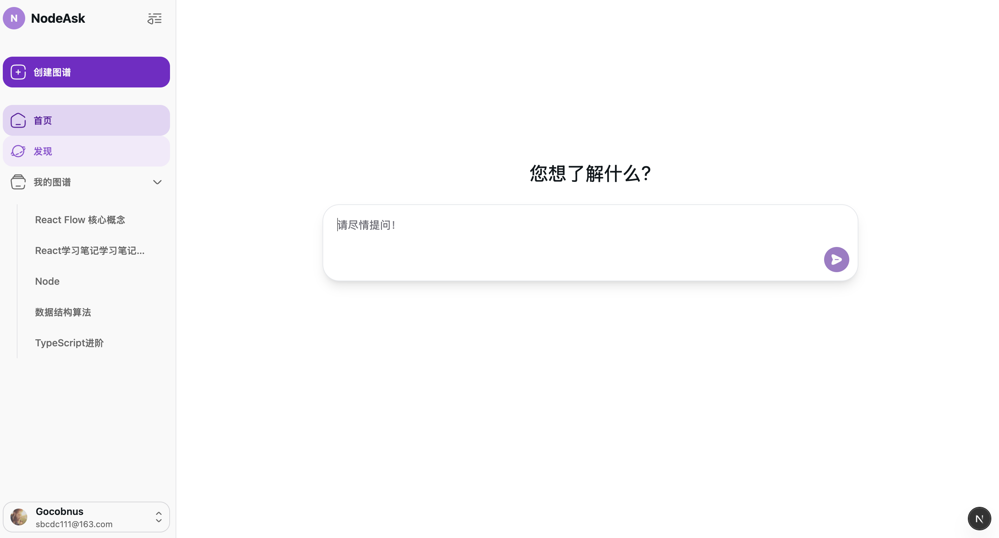
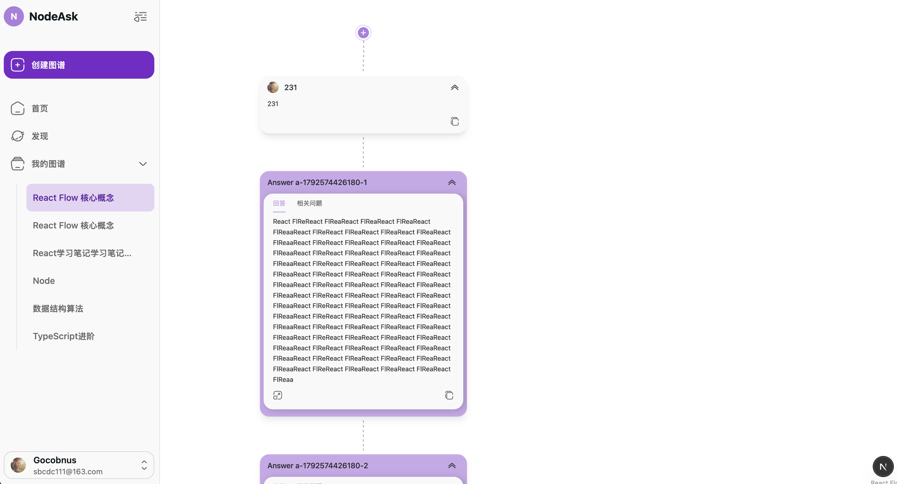
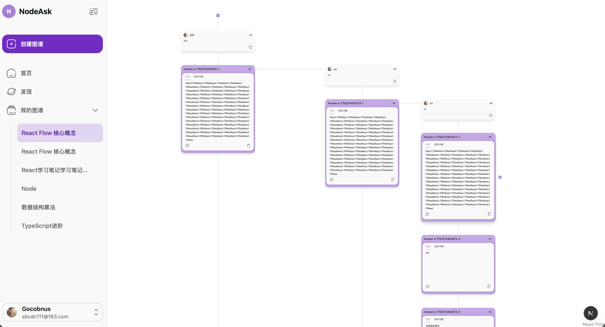
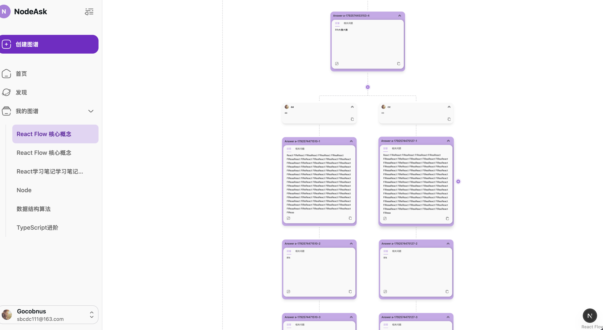
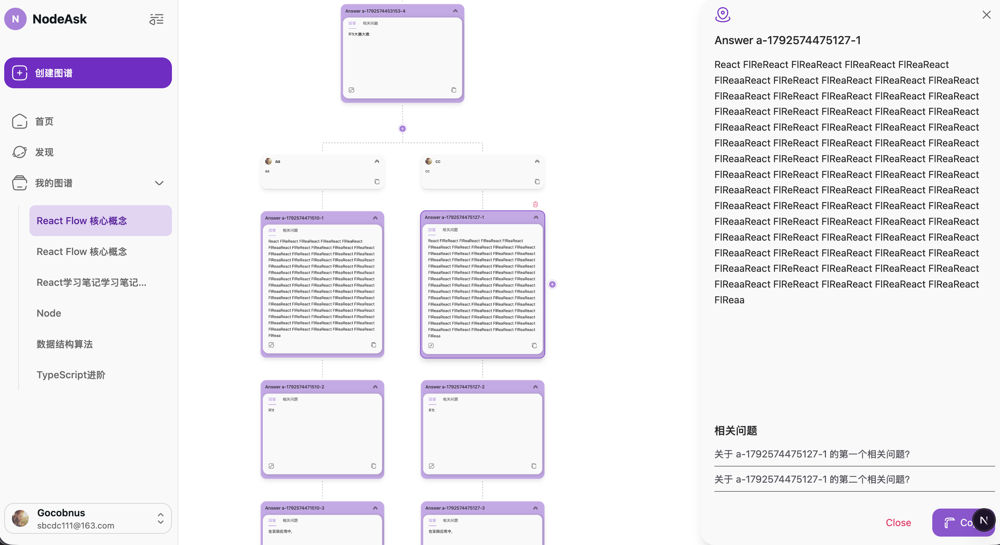

<!--
  项目截图 / 演示图预留位置
  将图片放入仓库后，可在这里插入项目截图或演示 GIF。
-->

# NodeAsk

NodeAsk 是一个以知识图谱形式组织 AI 对话的 Web 应用。它希望打破传统 AI 对话的线性结构，让用户可以围绕任意回答、任意卡片或任意历史节点继续提问，而不必始终沿着对话末端向下延伸。







## 为什么做这个项目

传统 AI 对话通常采用单一的链式结构。当我们想针对回答 A 中的某一部分继续追问时，只能在下一轮对话中提出问题。如果围绕回答 A 的追问越来越多，对话链就会变得很长；之后想重新理解某段内容时，往往需要不断向上追溯上下文。

NodeAsk 尝试用图谱和卡片解决这个问题：

- AI 的回答会根据 Markdown 结构自动拆分为多张独立卡片。
- 用户可以选择某张卡片横向追问，不需要关心它下方的其他内容，从而减少无关上下文，精简对话记忆。
- 用户可以随时选择过去的内容作为上下文，基于任意历史节点重新发起问答，而不是只能从当前对话的末尾继续。

## 当前能力

- 以图谱形式展示 AI 对话以及不同问题之间的分支关系。
- 根据 Markdown 内容自动拆分回答卡片。
- 围绕单张卡片进行独立追问。
- 选择历史节点，并基于过去的内容继续问答。

## 尚未实现

- 将多张拆分后的卡片重新合并为传统聊天中常见的单条完整回答。

这项能力目前仍处于设想阶段，尚未完成。

## 为什么暂时停止开发

目前这个项目已经暂停继续开发，主要有以下原因：

1. **可投入的时间有限**：作为个人项目，很难长期同时承担产品设计、前端开发、后端开发和维护工作。
2. **个人难以与企业团队竞争**：尤其是在 AI 应用领域，许多产品没有足够高的技术壁垒，个人开发者很难在开发速度、资源和持续迭代能力上与完整团队竞争。
3. **前端开发成本较高**：我主要是后端开发出身，而这个项目对前端交互、图谱布局和状态管理的要求较高，其中有许多问题暂时无法妥善解决。
4. **依赖 AI 反复修复的成本过高**：让 AI 协助解决前端问题时，经常出现解决了问题 A、又引入问题 B 的情况。反复修改和验证消耗了大量时间，维护成本也在持续增加。

暂时停止开发并不代表这个构想没有价值，只是以目前能够投入的时间和资源，还不足以把它持续打磨成一个成熟产品。

## 预期中的功能

如果未来重新推进，希望可以加入以下能力：

- 用户可以公开分享自己的 AI 知识图谱。
- 其他用户可以浏览和学习已分享的图谱，或在已有内容的基础上继续探索。
- 围绕知识图谱提供一定的社交功能，让用户能够发现内容、交流观点，并通过知识建立连接。

以上内容均为未来设想，目前尚未实现。

## 项目状态

> 当前项目已暂停开发。

现有版本可能并不完整，也可能存在尚未解决的问题。本仓库主要用于保留项目思路和当前实现。

## 本地运行

安装依赖：

```bash
npm install
```

启动开发服务器：

```bash
npm run dev
```

然后在浏览器中访问 [http://localhost:3000](http://localhost:3000)。

## 技术栈

- Next.js
- React
- TypeScript
- React Flow
- Tailwind CSS
- HeroUI
- TipTap
- Framer Motion
